# ChorePal – User Manual
**Version:** 1.0 

**Team Name:** Cowboys

**Date:** [10/10/2026]

---
## 1. Introduction
ChorePal is an Android app that helps families organize household chores in one place. Parents can create and assign chores, review a child's submitted photo, and approve completed work, while children can see their tasks and track rewards. ChorePal also includes progress information to help families understand how chores are going.

---
## 2. System Requirements

- **Hardware:**
  - Android phone or tablet with sufficient storage to install ChorePal.
  - A computer with at least 8 GB RAM and 40 GB of available storage is recommended for running the project through Android Studio.
  - A stable Wi-Fi or mobile data connection.

- **Software:**
  - Android 7.0 (Nougat) or newer, subject to compatibility with the app build.
  - Android Studio Ladybug (2024.2.1) or newer for building and running the project from source.
  - JDK 21 for development and building the application.
  - Windows, macOS, or Linux for development.

- **Other Dependencies:**
  - Firebase Authentication for account registration and login.
  - Cloud Firestore for storing household, chore, and related application data.
  - Firebase configuration and required services must be set up for the app to function correctly.
  - Google Play Services may be required for Google sign-in features.
  - Camera or photo library access for submitting chore completion photos.
  - An internet connection is required for Firebase-connected features.
---
## 3. Installation Guide
### Option 1: Install Using the APK

1. Obtain the ChorePal APK provided by the project team.
2. Transfer the APK to your Android phone.
3. Open the APK file from your Downloads folder.
4. If Android displays a security warning, verify that the APK came from the ChorePal project team before proceeding.
5. Follow the on-screen instructions to install the application.
6. Open ChorePal from your phone's app list.
7. Make sure your phone has an active internet connection to use Firebase-connected features.

### Option 2: Run Through Android Studio

1. Install Android Studio on your computer.
2. Download or clone the ChorePal project from the project repository:
   https://github.com/Monory1227/Capstone-Project-ChorePal
3. Open Android Studio and select **Open**.
4. Navigate to the downloaded ChorePal project folder and open it.
5. Wait for Gradle synchronization to finish.
6. Select an Android emulator or connect a compatible Android phone.
7. Click the green **Run** button in Android Studio.
8. Wait for the application to build and launch on the selected device.

**Note:** Running the project through Android Studio requires the project's Firebase configuration and dependencies to be set up correctly. Regular users installing the APK do not need to install Android Studio.

---
## 4. Getting Started
1. **Launch the Application:** Open ChorePal by tapping its icon on your Android phone or by running the project through Android Studio.
2. **Create an Account:** If you are a new user, select the registration option and enter the required information.
3. **Log In:** If you already have an account, enter your email and password to log in.
4. **Select Your Role:** Use the appropriate Parent or Child account, depending on your role in the household.
5. **Set Up Your Household:** Parents can manage household members and connect child accounts using the available options.
6. **Explore the Application:** Parents can create and assign chores, while children can view their assigned chores and submit completed work.
7. **Check Progress:** Review chore statuses and available rewards or progress information.
---

## 5. Features & Functions

### Feature 1: Account Registration and Login

**Description:** This feature allows parents and children to create accounts and log in to ChorePal.

**How to Use:**

1. Open the ChorePal application.
2. Select the registration option if you are a new user.
3. Enter the required information to create an account.
4. If you already have an account, enter your email and password to log in.

**Screenshots/Examples:**

**Registration Screen**

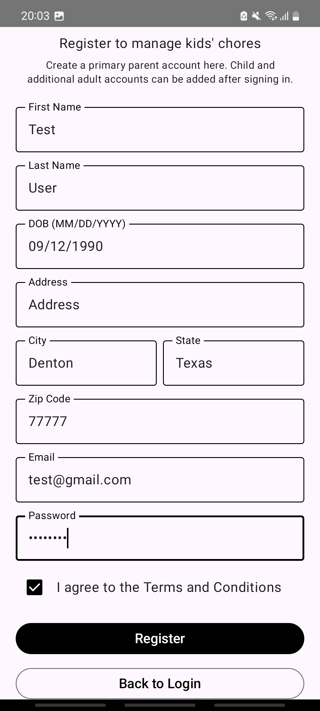

**Login Screen**

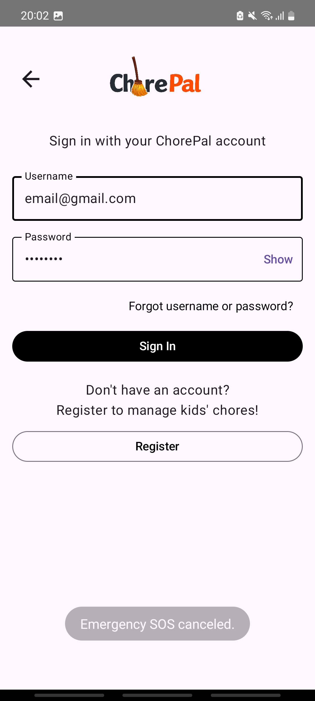

---

### Feature 2: Household Management

**Description:** This feature allows parents to manage their household, add children, and view household members.

**How to Use:**

1. Log in using a parent account.
2. View the parent dashboard to access household management options.
3. Open the household section.
4. Use the add child option to add a child to the household.
5. Open the household members section to view the family members.

**Screenshots/Examples:**

**Parent Dashboard**

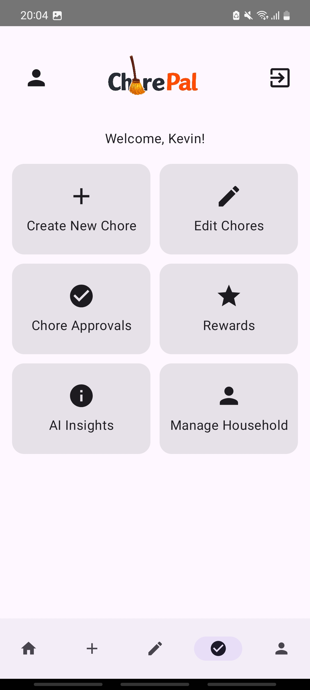

**Household Screen**

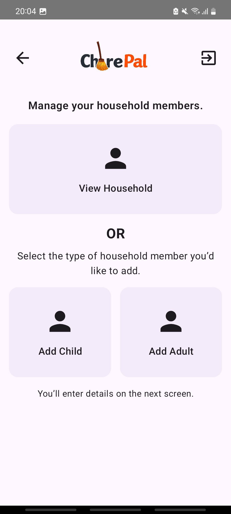

**Add Child Screen**

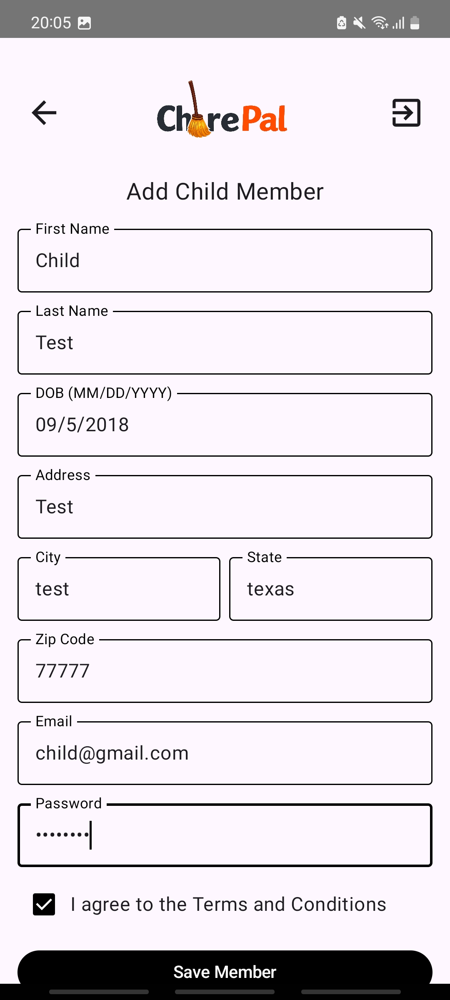

**View Household Members**

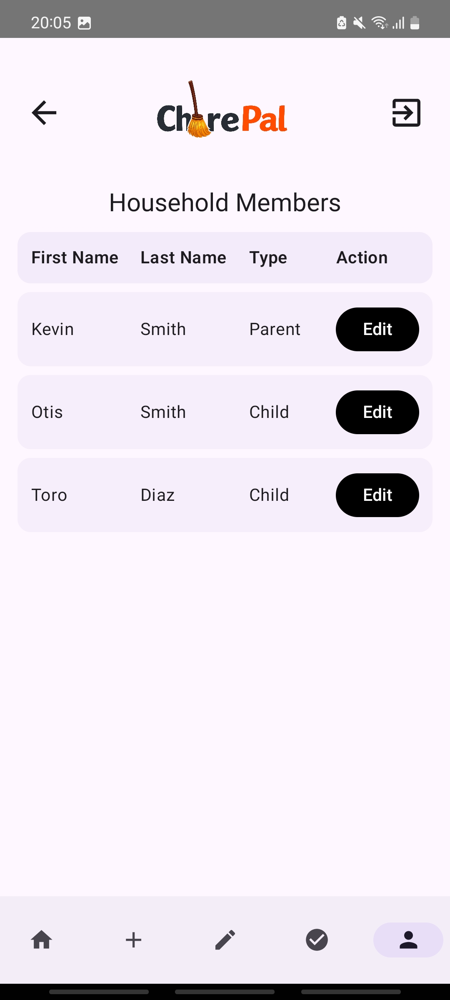

---

### Feature 3: Chore Assignment

**Description:** This feature allows parents to create chores and assign them to children.

**How to Use:**

1. Log in using a parent account.
2. Open the chore assignment section.
3. Select the option to create a new chore.
4. Enter the chore details and assign it to the appropriate child.
5. Save the chore and verify that it appears in the child's assigned chores list.

**Screenshots/Examples:**

**Parent-Side Chore Assignment**

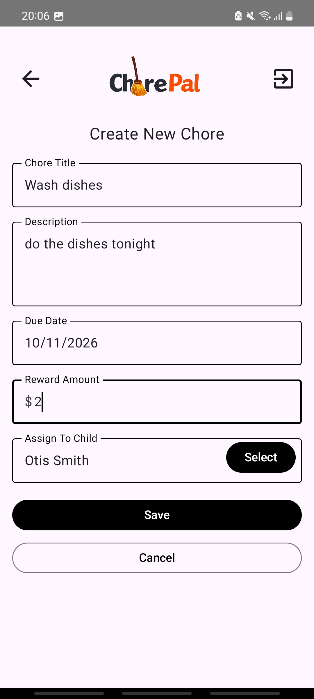

**Child's Chore Screen**

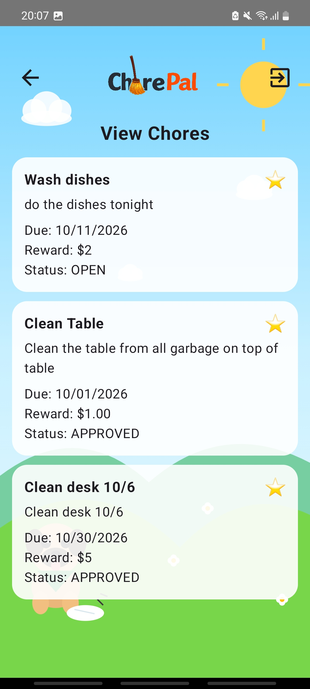

---

### Feature 4: Chore Completion and Photo Submission

**Description:** This feature allows children to view their assigned chores, complete tasks, and submit photos as proof of completion.

**How to Use:**

1. Log in using a child account.
2. Open the assigned chores section.
3. Select the chore to complete.
4. Complete the assigned task.
5. Follow the submission instructions and attach a photo of the completed chore.
6. Submit the chore for parent review.

**Screenshots/Examples:**

**Chore Assigned to Child:**

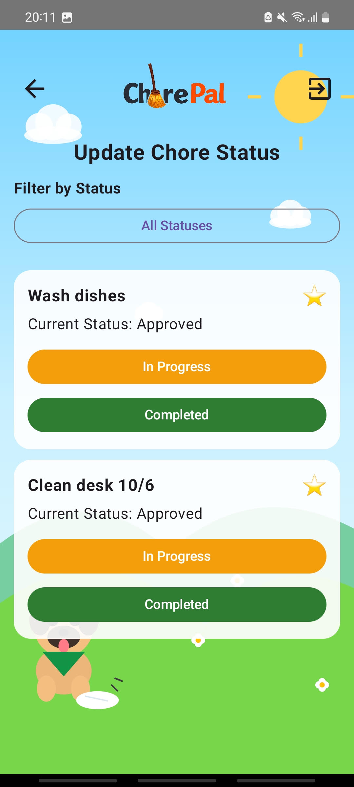

**Photo Submission**

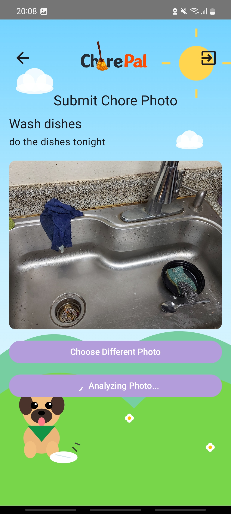

---

### Feature 5: Chore Review and Approval

**Description:** This feature allows parents to review submitted chores and approve or reject them. Children can view the status of their submissions.

**How to Use:**

1. Log in using a parent account.
2. Open the chore approval section.
3. Select a submitted chore and review its details and photo.
4. Approve or reject the chore submission.
5. Log in using the child's account to check the updated chore status.

**Screenshots/Examples:**

**Parent-Side Chore Approval**

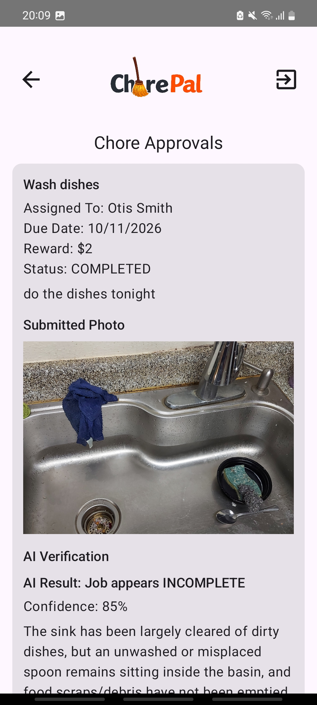

**Child Chore Approved**

---

### Feature 6: Rewards and Progress Tracking

**Description:** This feature allows children to view their rewards and parents to review reward information for their children.

**How to Use:**

1. Log in using a child account to view the available rewards.
2. Open the rewards section to review the child's reward information.
3. Log in using a parent account to view reward information for each child.
4. Review the displayed rewards and progress information.

**Screenshots/Examples:**

**Child-Side Rewards**

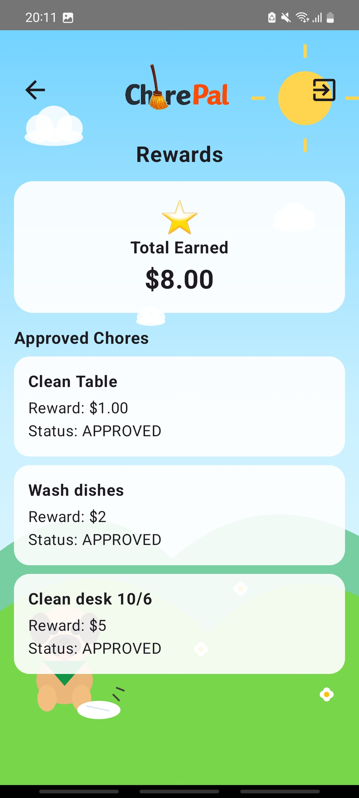

**Parent View of Child 1's Rewards**

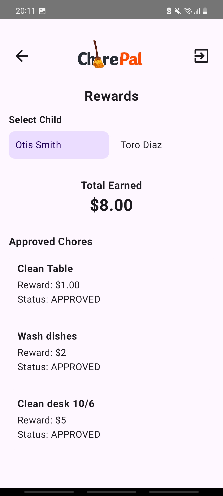

**Parent View of Child 2's Rewards**

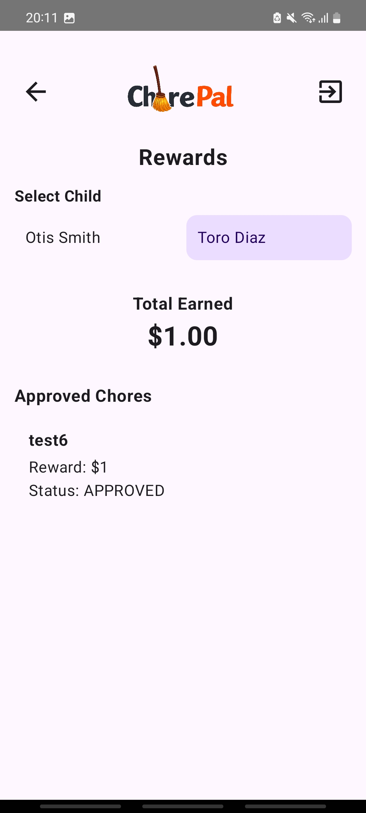

---

### Feature 7: AI Household Statistics and Insights

**Description:** This feature provides household statistics, performance comparisons, and AI-generated insights about chore activity and progress.

**How to Use:**

1. Log in using the appropriate account.
2. Open the household insights section.
3. Review the household chore statistics and activity.
4. Open the performance comparison section to review the available comparisons.
5. View the child insights section to review insights about individual chore activity and progress.

**Screenshots/Examples:**

**Household Insights**

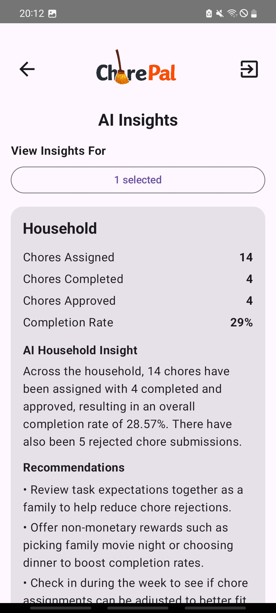

**Performance Comparison and AI Insights**

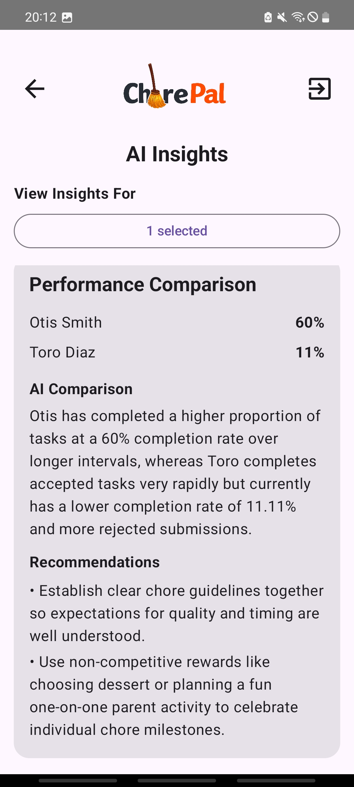

**Child Insights**

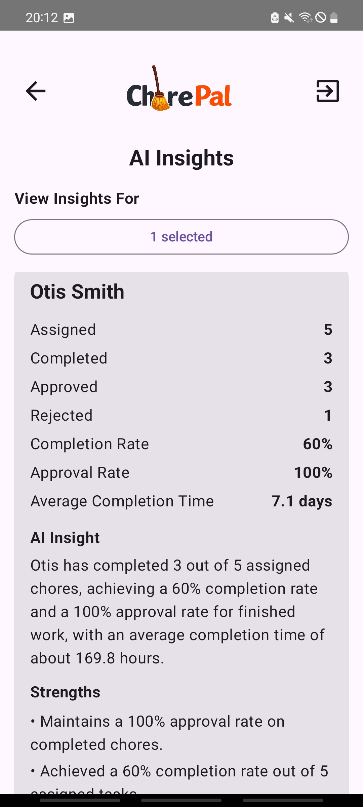
---

## 6. Troubleshooting examples
| Problem                         | Possible Cause                           | Solution                                                |
|---------------------------------|------------------------------------------|---------------------------------------------------------|
| ChorePal will not launch        | Installation issue or temporary error    | Reopen the app. Reinstall the APK if needed.            |
| Login fails                     | Incorrect email or password              | Verify your credentials and try again.                  |
| Registration fails              | Missing information or email in use      | Complete all required fields or use another email.      |
| Chores are not showing up       | Chores have not been assigned            | Ask the parent to verify the chore assignment.          |
| Photo submission fails          | Internet or photo permission issue       | Check your connection and photo permissions.            |
| Chore status does not update    | Submission awaits parent review          | Ask the parent to review the submission.                |
| Rewards are not updating        | Chore is pending approval                | Check the chore status and refresh the app.             |
| App data is not loading         | Internet or Firebase connection issue    | Check your connection and reopen the app.               |
| Child cannot see assigned chores| Wrong account or assignment issue        | Verify the child account and chore assignment.          |
| Parent cannot approve a chore   | Chore has not been submitted             | Ask the child to submit the completed chore.            |
| Photo upload takes too long     | Slow internet connection                 | Check the connection and try uploading again.           |
| Household members are missing   | Household setup issue                    | Check the household and member account settings.        |
| Account creation fails          | Email already registered or invalid data | Verify the information and try again.                   |
| Changes are not appearing       | Data has not refreshed                   | Reopen the screen and check the internet connection.    |
| AI insights are not loading     | Connection issue or feature unavailable  | Check the connection and try again later.               |

---
## 7. Contact Information
- **Support Email:** chaliseparth81@gmail.com
- **Project Repository:** [ChorePal GitHub Repository](https://github.com/Monory1227/Capstone-Project-ChorePal)

## 8. FAQ
**Q: What is ChorePal?**

**A:** ChorePal is an Android app that helps families manage household chores and track children's progress.

**Q: How do I create an account?**

**A:** Open ChorePal, select the registration option, and enter the required information.

**Q: What is the difference between Parent and Child accounts?**

**A:** Parents can manage household members, assign chores, and review submissions. Children can view assigned chores and submit completed work.

**Q: How do children submit completed chores?**

**A:** Open an assigned chore, complete the task, attach a photo if required, and submit it for parent review.

**Q: Why has my completed chore not been approved?**

**A:** The chore may still be waiting for the parent to review it. Ask the parent to check the submission.

**Q: How do I track rewards and progress?**

**A:** Open the available rewards or progress section to view your information.

**Q: What should I do if ChorePal is not working?**

**A:** Check your internet connection, close and reopen the app, and try again. If the problem continues, contact the project team.

**Q: Do I need Android Studio to use ChorePal?**

**A:** No. Regular users can install the APK provided by the project team. Android Studio is only needed to run or modify the source code.
